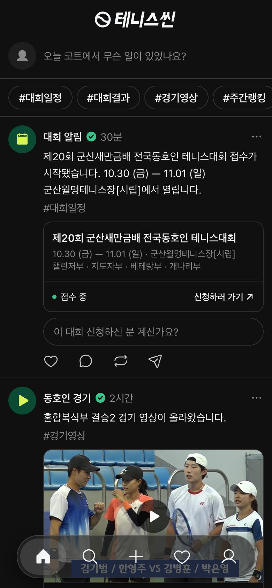
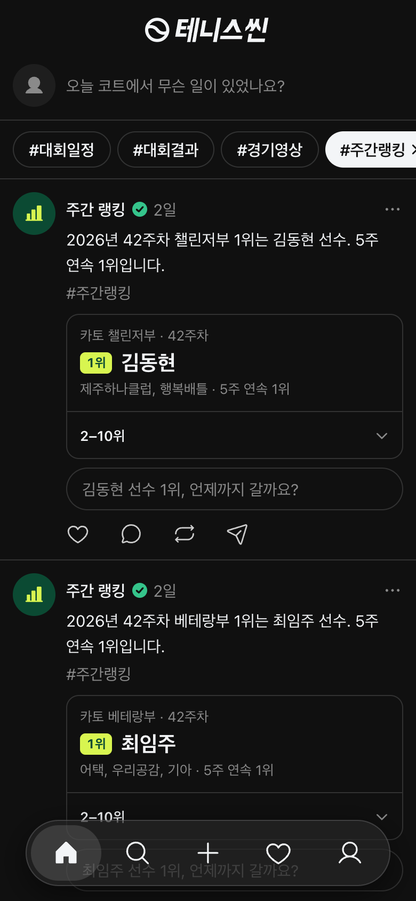
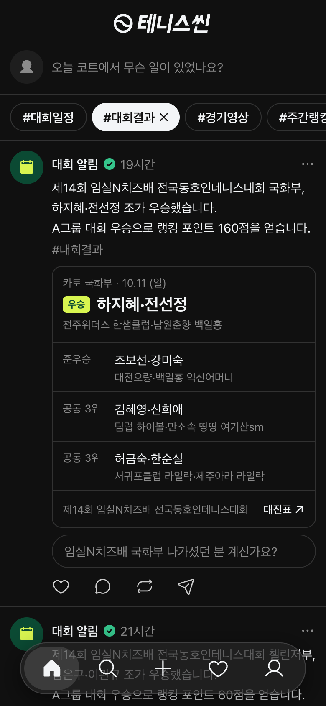

# 테니스씬 (Tennis Scene)

한국 아마추어 테니스 동호인을 위한 **단일 피드형 SNS**.
주간 랭킹·대회 결과·경기 영상이 봇 계정을 통해 자동으로 피드에 올라오고, 그 위에서 동호인들이 글을 쓰고 반응합니다.

> "이번 주 오픈부 1위가 누구인지, 스크롤만으로 알게 되는 곳."

**Live** · https://tennisscene.vercel.app


<p>
  
  
  
</p>

## 주요 기능

- **단일 피드** — 랭킹·대회·영상을 탭으로 쪼개지 않고 하나의 시간순 피드에 담습니다. 추천 알고리즘 없음.
- **데이터 봇 계정** — `@rank`(주간 랭킹), `@tour`(대회), `@match`(경기 영상), `@court`(레슨·장비)가 일반 유저와 같은 포스트 형식으로 게시합니다. 팔로우·댓글·인용이 그대로 따라옵니다.
- **자동 수집 파이프라인** — 카토(KATO) 랭킹·대회 결과와 유튜브 경기 영상을 매일 수집해 주간 다이제스트로 게시합니다. 게시 시각을 분산해 봇 글이 몰리지 않게 합니다.
- **AI 계정** — 날씨·레슨 노트·장비 글을 쓰는 AI 계정. 사람인 척하지 않고, 선수 실명을 AI에 넘기지 않는 원칙을 코드로 강제합니다.
- **커뮤니티 기능** — 실명/익명 글쓰기, 해시태그 필터, 검색, 반응·댓글, 푸시 알림.
- **운영·안전** — 신고·차단·욕설 필터·이용 정지, 관리자 페이지, 약관·개인정보 처리방침과 가입 동의, 탈퇴 1년 뒤 삭제.
- **웹 + 네이티브 앱** — PWA 웹앱과 Expo(React Native) 앱이 같은 서버 API를 씁니다.

## 아키텍처

```
외부 소스 (카토 · 유튜브)
   │  src/lib/sources/   어댑터 — 파싱만, DB를 모른다 (소스 URL 이관에 대비)
   ▼
src/lib/publish/        payload·본문 생성 (순수 함수)
   ▼
src/lib/jobs/           수집·게시 잡 — CLI(scripts/)와 Vercel 크론이 같은 함수를 호출
   ▼
Supabase (PostgreSQL)   posts 단일 테이블 + type + payload(jsonb), RLS로 권한 제어
   ▼
Next.js 웹 · Expo 앱     PostCard → Attachment가 type으로 분기해 렌더링
```

- 포스트 종류를 늘릴 때 테이블을 늘리지 않습니다. `types.ts`의 `Attachment` 유니온과 렌더러만 추가합니다.
- 크론은 매일 09:00 KST에 돌고, 월요일에만 주간 랭킹까지 게시합니다. 잡마다 실행 기록(`job_runs`)을 남깁니다.

## 폴더 구조

| 경로 | 역할 |
| --- | --- |
| `src/app/` | Next.js App Router — 피드·검색·활동·프로필, 글쓰기, 관리자, 약관, API |
| `src/components/` | 피드·포스트 카드·글쓰기·로그인 등 UI |
| `src/lib/sources/` | 외부 데이터 소스 어댑터 |
| `src/lib/jobs/` | 수집·게시 잡 |
| `src/lib/ai/` | AI 계정의 목소리와 공통 규칙 |
| `supabase/migrations/` | DB 스키마·RLS·검색 함수 마이그레이션 |
| `scripts/` | 잡 CLI (`--dry-run`, `--fixture`, `--sql`) |
| `mobile/` | Expo 네이티브 앱 |
| `tests/` | 파서·게시 로직 테스트와 픽스처 |
| `docs/` | 설계 결정(`DECISIONS.md`)·디자인(`DESIGN.md`)·로드맵(`ROADMAP.md`) |

## 시작하기

```bash
npm install
cp .env.example .env.local   # Supabase·유튜브 키 입력
npm run dev                  # http://localhost:3000
```

| 명령 | 설명 |
| --- | --- |
| `npm test` | 테스트 실행 |
| `npm run kato` | 카토 랭킹 수집 |
| `npm run snapshot` | 주간 랭킹 스냅샷 생성 |
| `npm run publish` | 피드 게시 잡 실행 |
| `npm run schema` | 마이그레이션으로 `supabase/schema.sql` 생성 |

## 데이터 원칙

카토(kato.kr)에 공개된 부서별 상위 랭킹만 사용하며, 전수 수집이나 회원 DB 구축은 하지 않습니다.
가입 시 생년월일·성별·전화번호를 받지 않습니다.
